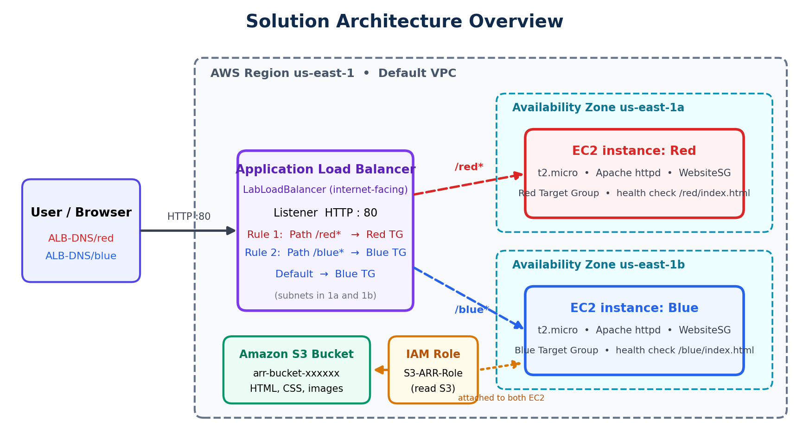
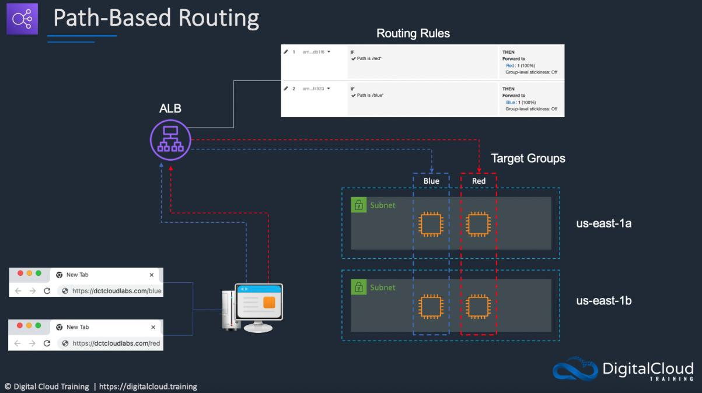

# Load Balanced Architecture with Advanced Request Routing on AWS


A hands-on AWS project that hosts a two-page website on **Amazon EC2** behind an **Application Load Balancer (ALB)**
and routes each request to the right server using **path-based** and **host-based** routing rules.

**Author:** Rutuja Naik

> Based on the *Cloud Mastery Bootcamp* lab by Digital Cloud Training. This repository is my own write-up,
> with extra explanation, troubleshooting and diagrams.

---

## Table of contents

1. [What this project demonstrates](#what-this-project-demonstrates)
2. [Architecture](#architecture)
3. [AWS services and resources](#aws-services-and-resources)
4. [Prerequisites](#prerequisites)
5. [Quick start](#quick-start)
6. [Detailed deployment guide](#detailed-deployment-guide)
7. [How routing works](#how-routing-works)
8. [Testing and verification](#testing-and-verification)
9. [Troubleshooting](#troubleshooting)
10. [Cost and clean-up](#cost-and-clean-up)
11. [Security notes](#security-notes)
12. [Repository structure](#repository-structure)
13. [What I learned](#what-i-learned)
14. [Credits and license](#credits-and-license)

---

## What this project demonstrates

- Storing website files in **S3** and pulling them onto servers at boot using **EC2 user data**.
- Giving EC2 secure, least-privilege access to S3 with an **IAM role** (no access keys on the instance).
- Running two web servers (**Red** and **Blue**) in two **Availability Zones**.
- Creating **target groups** with custom **health checks**.
- Creating an internet-facing **Application Load Balancer** with an HTTP:80 listener.
- Using **path-based routing** (`/red*`, `/blue*`) and **host-based routing** (host header rules).

## Architecture



| Component | Detail |
|-----------|--------|
| Region | `us-east-1` |
| Red EC2 instance | `t2.micro`, Apache httpd, subnet in `us-east-1a`, serves `/red` |
| Blue EC2 instance | `t2.micro`, Apache httpd, subnet in `us-east-1b`, serves `/blue` |
| Load balancer | `LabLoadBalancer`, internet-facing, subnets in both AZs |
| Listener | HTTP : 80, default action forwards to **Blue** |
| Rules | Priority 1: path `/red*` to **Red**. Priority 2: path `/blue*` to **Blue** |

More diagrams: [path-based routing](docs/images/path-based-routing.png) and
[host-based routing](docs/images/host-based-routing.png).

## AWS services and resources

| Resource | Name | Purpose |
|----------|------|---------|
| S3 bucket | `arr-bucket-<random digits>` | Holds the web pages and assets |
| Security group | `WebsiteSG` | Inbound HTTP (TCP 80) from `0.0.0.0/0` |
| IAM policy | `S3-ARR-Policy` | Read access to the bucket |
| IAM role | `S3-ARR-Role` | Instance profile used by both EC2 instances |
| EC2 instances | `Red`, `Blue` | Apache web servers |
| Target groups | `Red`, `Blue` | Health checks on `/red/index.html` and `/blue/index.html` |
| Load balancer | `LabLoadBalancer` | Routes requests with listener rules |

## Prerequisites

- An AWS account (Free Tier is enough, though the ALB is not free-tier eligible in every account, see [Cost](#cost-and-clean-up)).
- Basic familiarity with the AWS Management Console.
- The lab code files (`advanced-request-routing-code.zip`): the Red/Blue web pages, the two user data scripts and `bucket-permissions.json`. These are course files and are **not** included here.

## Quick start

1. **S3:** create a bucket and upload all lab files *except* the user data files and `bucket-permissions.json`.
2. **Security group:** create `WebsiteSG` allowing HTTP 80 from `0.0.0.0/0`.
3. **IAM:** create policy `S3-ARR-Policy` (see [`policies/`](policies/)), then role `S3-ARR-Role` for EC2 with that policy.
4. **EC2:** launch `Red` (us-east-1a) and `Blue` (us-east-1b), `t2.micro`, with `WebsiteSG`, `S3-ARR-Role` and the matching user data (see [`scripts/`](scripts/)).
5. **Target groups:** create `Red` (health check `/red/index.html`) and `Blue` (`/blue/index.html`) and register each instance.
6. **ALB:** create `LabLoadBalancer`, both AZs, `WebsiteSG`, listener HTTP:80 with default action forward to `Blue`.
7. **Rules:** add `/red*` (priority 1, to Red) and `/blue*` (priority 2, to Blue).
8. **Test:** open `http://<ALB-DNS-name>/red` and `http://<ALB-DNS-name>/blue`.

The full click-by-click version is in [`docs/DEPLOYMENT-GUIDE.md`](docs/DEPLOYMENT-GUIDE.md).

## Detailed deployment guide

| Document | Contents |
|----------|----------|
| [docs/DEPLOYMENT-GUIDE.md](docs/DEPLOYMENT-GUIDE.md) | Every phase step by step, with screenshots |
| [docs/ARCHITECTURE.md](docs/ARCHITECTURE.md) | Design decisions and how the pieces fit together |
| [docs/TROUBLESHOOTING.md](docs/TROUBLESHOOTING.md) | Common problems and how to fix them |
| [docs/index.html](docs/index.html) | The same documentation as a single web page (GitHub Pages ready) |
| [docs/Project-Documentation.pdf](docs/Project-Documentation.pdf) | Printable PDF version |

## How routing works

The ALB evaluates listener rules from the **lowest priority number to the highest**. The first matching rule
decides the target group. If nothing matches, the **default action** is used.

| Priority | Condition | Action |
|----------|-----------|--------|
| 1 | Path is `/red*` | Forward to **Red** |
| 2 | Path is `/blue*` | Forward to **Blue** |
| Default | none matched | Forward to **Blue** |



**Host-based routing** (optional) swaps the two path rules for *HTTP host header* rules
(`red.<your-domain>` to Red, `blue.<your-domain>` to Blue). Because the rules only match the `Host` header, you can test
them without any DNS changes:

```bash
curl -H "Host: red.example.com"  http://<ALB-DNS-name>/
curl -H "Host: blue.example.com" http://<ALB-DNS-name>/
```

## Testing and verification

| Check | Expected |
|-------|----------|
| Target group `Red` | Instance shows **healthy** |
| Target group `Blue` | Instance shows **healthy** |
| ALB state | **Active** |
| `http://<ALB-DNS-name>/red` | Red page |
| `http://<ALB-DNS-name>/blue` | Blue page |
| `http://<ALB-DNS-name>/` | Blue page (default action) |

```bash
curl -I http://<ALB-DNS-name>/red
curl -I http://<ALB-DNS-name>/blue
```

## Troubleshooting

| Symptom | Likely cause |
|---------|--------------|
| Target is **unhealthy** | Wrong health check path, `httpd` not running, or user data failed |
| `502` / `503` from the ALB | No healthy targets in the target group |
| Page shows Apache default page | Files were not copied from S3 (bucket name or role problem) |
| Request times out | Security group does not allow HTTP 80 |

Details and commands are in [docs/TROUBLESHOOTING.md](docs/TROUBLESHOOTING.md).

## Cost and clean-up

The **Application Load Balancer** and **EC2 instances** can incur charges (and the S3 bucket costs a little).
Delete everything when you finish:

1. Load balancer `LabLoadBalancer`
2. Target groups `Red` and `Blue`
3. EC2 instances `Red` and `Blue`
4. Security group `WebsiteSG`
5. S3 bucket (empty it first)
6. Optional: IAM role `S3-ARR-Role` and policy `S3-ARR-Policy`

## Security notes

- `WebsiteSG` is open to the whole internet on port 80 because this is a public demo site. Do not reuse that rule for anything private.
- The instances use an **IAM role**, so no access keys are stored on them.
- The policy grants only read access to this one bucket.
- The listener uses plain HTTP. For production, add an HTTPS listener with an ACM certificate and redirect HTTP to HTTPS.
- Never commit key files or credentials (the `.gitignore` already excludes `*.pem`, `*.key`, `.env`).

## Repository structure

```
aws-alb-advanced-request-routing/
├── README.md
├── LICENSE
├── .gitignore
├── docs/
│   ├── index.html                 # single-page docs site (GitHub Pages)
│   ├── DEPLOYMENT-GUIDE.md
│   ├── ARCHITECTURE.md
│   ├── TROUBLESHOOTING.md
│   ├── Project-Documentation.pdf
│   └── images/                    # diagrams and console screenshots
├── scripts/
│   ├── README.md
│   └── user-data-red.sh
└── policies/
    ├── README.md
    └── s3-read-policy.example.json
```

## What I learned

- One ALB can front several applications by routing on the URL path or the host header.
- Listener rules are evaluated by priority, and the default rule catches everything else.
- A target group health check must point to a path that really exists on the instance.
- IAM roles are the safe way to let EC2 read from S3.
- Spreading instances across two Availability Zones improves availability.

## Credits and license

- Lab guide, code files and the original routing diagrams and screenshots: **Digital Cloud Training**, *Cloud Mastery Bootcamp*.
- Overview diagram, write-up and extra documentation: **Rutuja Naik**, released under the [MIT License](LICENSE).
