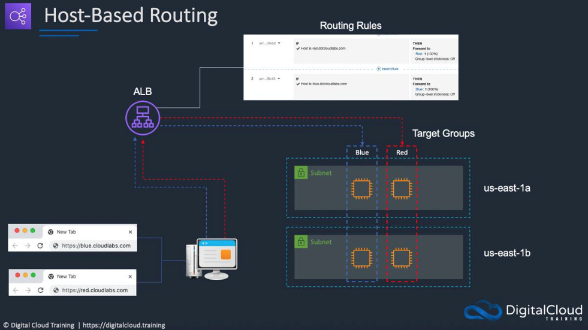

# Architecture

## Request flow

1. A user opens `http://<ALB-DNS-name>/red` (or `/blue`) in a browser.
2. DNS resolves the ALB name to addresses in both Availability Zones; the request arrives on **listener HTTP:80**.
3. The ALB evaluates the listener rules in priority order.
4. The matching rule forwards the request to a **target group**.
5. The ALB picks a **healthy** target in that group and forwards the request over HTTP port 80.
6. Apache on the instance returns `/var/www/html/red/index.html` (or the blue equivalent).

## Components

### Amazon S3
Stores the HTML, CSS and image files. Keeping the content in S3 means the instances can be rebuilt at any time
by simply launching them again with the user data script.

### IAM role and instance profile
`S3-ARR-Role` is attached to both instances. The AWS CLI on the instance automatically uses the role's temporary
credentials, so `aws s3 cp` works without access keys. The attached policy only allows reading this one bucket.

### Security group
`WebsiteSG` allows inbound HTTP on TCP 80 from `0.0.0.0/0`. The same group is used by the ALB and the instances
to keep the lab simple. In production you would give the instances a group that only accepts traffic from the ALB's group.

### EC2 instances
Two `t2.micro` instances running Apache httpd. **Red** is in `us-east-1a`; **Blue** is in `us-east-1b`. Each serves its page
from a folder named after its colour (`/var/www/html/red`, `/var/www/html/blue`), which is why the path rules work:
the ALB forwards the full path unchanged.

### Target groups
| Target group | Health check path |
|--------------|-------------------|
| Red | `/red/index.html` |
| Blue | `/blue/index.html` |

The health check path must exist on the instance, otherwise the target is marked unhealthy and the ALB will not send traffic to it.

### Application Load Balancer
Internet-facing, spans `us-east-1a` and `us-east-1b`, uses `WebsiteSG`. One listener on HTTP:80 with default action *forward to Blue*.

## Path-based routing

| Priority | Condition | Target group |
|----------|-----------|--------------|
| 1 | Path `/red*` | Red |
| 2 | Path `/blue*` | Blue |
| Default | any other request | Blue |

## Host-based routing

| Priority | Condition | Target group |
|----------|-----------|--------------|
| 1 | Host header `red.<your-domain>` | Red |
| 2 | Host header `blue.<your-domain>` | Blue |
| Default | any other request | Blue |

Host-based routing lets one load balancer serve several domains or subdomains. Each hostname must resolve to the ALB
for browsers to reach it; the rule itself only inspects the `Host` header.

## Path-based vs host-based

| | Path-based | Host-based |
|---|---|---|
| Routing key | URL path | `Host` header |
| Rule condition | Path | HTTP host header |
| Good for | Sections of one site (`/api`, `/images`) | Separate sites or subdomains |
| Needs extra hostnames | No | Yes |

## Design decisions and possible improvements

| Decision in this lab | Production improvement |
|----------------------|------------------------|
| One instance per target group | Several instances per group (or an Auto Scaling group) |
| HTTP only | HTTPS listener with an ACM certificate and HTTP-to-HTTPS redirect |
| One shared security group | Separate ALB and instance groups; instances accept traffic only from the ALB group |
| Manual console setup | Infrastructure as Code (CloudFormation, Terraform or CDK) |
| Public instances | Private subnets for instances, ALB in public subnets |
