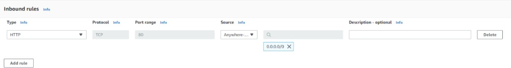
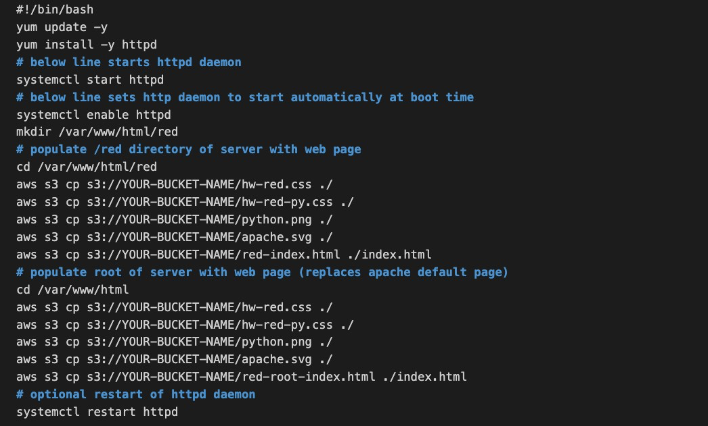
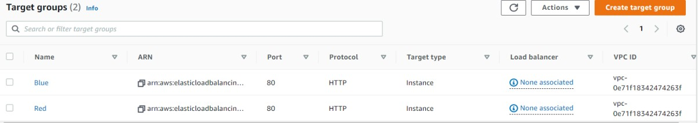
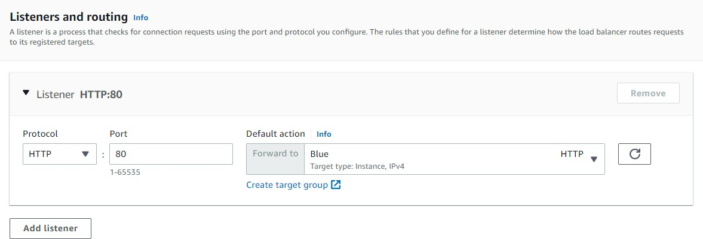
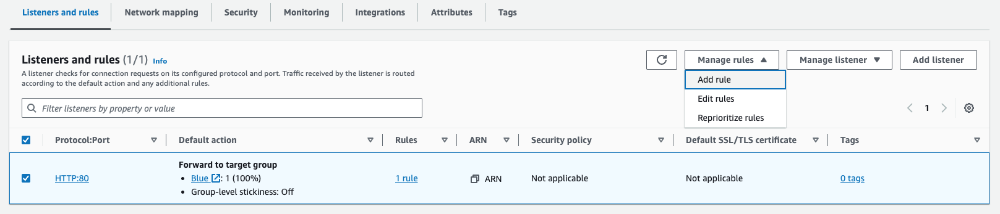
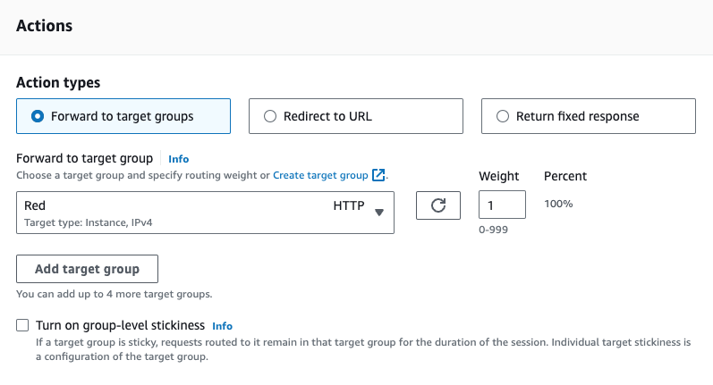
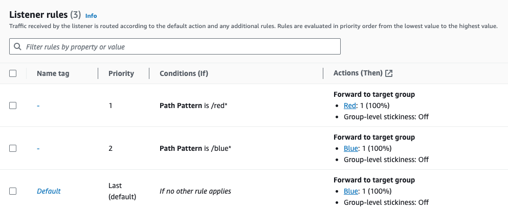
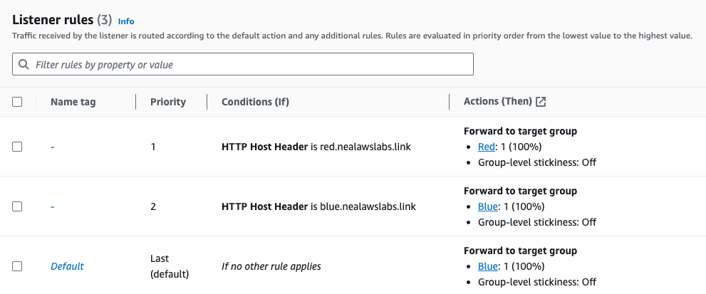

# Deployment Guide

Follow the phases in order. Names used here (`WebsiteSG`, `S3-ARR-Role`, `Red`, `Blue`, `LabLoadBalancer`) are the ones used throughout the project.

> Region: **us-east-1**. Subnets: **us-east-1a** for Red, **us-east-1b** for Blue.

---

## Phase 1: Create the S3 bucket and upload the code

1. Open the **S3 console** and click **Create bucket**.
2. Enter a globally unique name, for example `arr-bucket-123456`. **Note the name down.**
3. Scroll down and click **Create bucket**.
4. Extract `advanced-request-routing-code.zip`.
5. Upload **all files except** the user data files and `bucket-permissions.json`.

## Phase 2: Create the security group and IAM role

### Security group `WebsiteSG`

1. **EC2 console > Network & Security > Security Groups > Create security group**.
2. Name `WebsiteSG`, description `WebsiteSG`.
3. Add one inbound rule: **HTTP**, TCP, port **80**, source **Anywhere-IPv4 (0.0.0.0/0)**.
4. Click **Create security group**.



### IAM policy and role

1. **IAM console > Policies > Create policy > JSON**.
2. Paste the contents of `bucket-permissions.json` (or [`../policies/s3-read-policy.example.json`](../policies/s3-read-policy.example.json)), replacing `YOUR-BUCKET-ARN` with your bucket ARN (for example `arn:aws:s3:::arr-bucket-123456`).
3. Name the policy `S3-ARR-Policy` and create it.
4. **Roles > Create role**, trusted entity **EC2**, click **Next**.
5. Attach `S3-ARR-Policy`, name the role `S3-ARR-Role`, create it.

## Phase 3: Launch the Red and Blue EC2 instances

### Red

1. **EC2 console > Launch instance**.
2. Name: `Red`. Choose an Amazon Linux AMI and instance type **t2.micro**.
3. Key pair: **Proceed without a key pair**.
4. Network settings: select security group `WebsiteSG` and a subnet in **us-east-1a**.
5. Expand **Advanced details**, set **IAM instance profile** to `S3-ARR-Role`.
6. In **User data**, paste [`../scripts/user-data-red.sh`](../scripts/user-data-red.sh) after replacing `YOUR-BUCKET-NAME` with your bucket name.
7. Click **Launch instance**.



### Blue

Repeat the steps with these changes:

- Name `Blue`
- Subnet in **us-east-1b**
- User data from the `user-data-blue` file in the lab zip (bucket name replaced)
- Same `WebsiteSG` and `S3-ARR-Role`

**Check:** open each instance's public IP with `/red` or `/blue` appended. The custom page should load.

## Phase 4: Create the target groups

Go to **EC2 > Load Balancing > Target Groups > Create target group**.

| Setting | Red | Blue |
|---------|-----|------|
| Target type | Instances | Instances |
| Name | `Red` | `Blue` |
| Port | 80 | 80 |
| VPC | your VPC | your VPC |
| Health check path | `/red/index.html` | `/blue/index.html` |
| Instance to register | Red | Blue |

For each: click **Next**, select the instance, click **Include as pending below**, then **Create target group**.



## Phase 5: Create the Application Load Balancer

1. **EC2 > Load Balancers > Create load balancer > Application Load Balancer**.
2. Name `LabLoadBalancer`, scheme **Internet-facing**.
3. Network mapping: select **us-east-1a** and **us-east-1b**.
4. Security group: `WebsiteSG`.
5. Listener **HTTP : 80**, default action **Forward to** target group `Blue`.
6. Click **Create load balancer** and wait until the state is **Active**.



## Phase 6: Configure path-based routing rules

1. Open the load balancer, **Listeners and rules** tab.
2. Tick the **HTTP:80** listener, then **Manage rules > Add rule**.



### Red rule

- Condition: **Path**, value `/red*`
- Action: **Forward to target groups**, `Red`
- Priority: **1**



### Blue rule

- Condition: **Path**, value `/blue*`
- Action: **Forward to target groups**, `Blue`
- Priority: **2**

### Expected result



### Test

Copy the ALB **DNS name** and open:

- `http://<ALB-DNS-name>/red` shows the Red page
- `http://<ALB-DNS-name>/blue` shows the Blue page

## Phase 7: Configure host-based routing (optional)

1. Open the listener, **Manage rules > Edit rules**, and delete the two path rules.
2. Add a rule: condition **HTTP host header** = `red.yourdomainname.com`, forward to `Red`, priority **1**.
3. Add a rule: condition **HTTP host header** = `blue.yourdomainname.com`, forward to `Blue`, priority **2**.



*(The screenshot shows example hostnames from the original lab. Use your own domain.)*

Test the rules without DNS by sending the header yourself:

```bash
curl -H "Host: red.yourdomainname.com"  http://<ALB-DNS-name>/
curl -H "Host: blue.yourdomainname.com" http://<ALB-DNS-name>/
```

## Phase 8: Clean up

Delete in this order to avoid dependency errors:

1. Load balancer `LabLoadBalancer`
2. Target groups `Red` and `Blue`
3. EC2 instances `Red` and `Blue` (terminate)
4. Security group `WebsiteSG`
5. S3 bucket (empty it, then delete it)
6. Optional: IAM role `S3-ARR-Role` and policy `S3-ARR-Policy`
